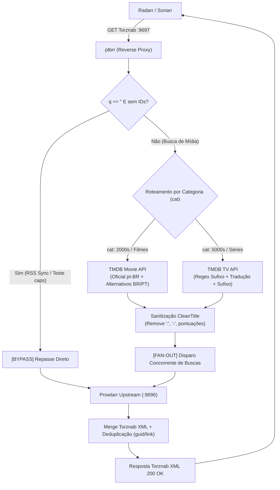

# 🇧🇷 ptbrr: Torznab pt-BR Reverse Proxy & Fan-Out Aggregator

[](https://goreportcard.com/report/github.com/zwlucas/ptbrr)
[](LICENSE)
[](https://github.com/zwlucas/ptbrr/releases)

**ptbrr** é um middleware de proxy reverso e agregador fan-out ultraleve e de alta performance desenvolvido em **Go** (exclusivamente com a biblioteca padrão, **zero dependências externas**). 

Ele intercepta requisições Torznab enviadas simultaneamente pelo **Radarr** (Filmes) e pelo **Sonarr** (Séries de TV) para o **Prowlarr**, traduz termos de pesquisa em inglês para títulos em português brasileiro (**pt-BR**) e títulos alternativos via API do TMDB em tempo real, executa buscas concorrentes no Prowlarr e funde os feeds XML resultantes sem duplicatas.

Isso resolve a limitação crônica de rastreadores públicos (ex: The Pirate Bay, 1337x) e trackers que apenas indexam conteúdos nacionais, dublados ou dual áudio sob títulos em português.

---

## ✨ Funcionalidades Principais

- **Roteamento Inteligente por Categoria (`cat`)**:
  - **Radarr (Filmes)**: Categorias na faixa dos `2000` (ex: `2000, 2030, 2040`) ou `t=movie` utilizam os endpoints de filmes do TMDB (`/search/movie`, `/movie/{id}` e `/movie/{id}/alternative_titles`).
  - **Sonarr (Séries)**: Categorias na faixa dos `5000` (ex: `5000, 5030, 5040`) ou `t=tvsearch` ativam o fluxo de TV do TMDB (`/search/tv`, `/tv/{id}` e `/tv/{id}/alternative_titles`).
- **Fan-Out Aggregator Concorrente**:
  - Consulta o TMDB concorrentemente para obter o título oficial pt-BR e todos os títulos alternativos válidos no Brasil (`iso_3166_1: BR`) e Portugal (`PT`).
  - Dispara requisições HTTP paralelas via goroutines e `sync.WaitGroup` para o Prowlarr upstream.
- **Fusão e Deduplicação de Feeds Torznab XML**:
  - Desconstrói as respostas XML RSS 2.0 recebidas do Prowlarr, preserva elementos brutos (`xml:",innerxml"`) e unifica todos os `<item>` num único feed.
  - Elimina torrents duplicados com base no `<guid>` e `<link>`.
- **Sanitização de Títulos (`CleanTitle`)**:
  - Remove pontuações rejeitadas por trackers públicos (`:`, `-`, `,`, `.`, `!`, `?`, `_`, `'`, `"`, etc.) e normaliza espaçamentos para maximizar correspondências (ex: *"Vingadores: Ultimato"* vira *"Vingadores Ultimato"*).
- **Extração e Reanexação de Sufixo de Temporada/Episódio**:
  - Expressões regulares separam o título base da série do sufixo de episódio (ex: *"Breaking Bad S01E01"* -> *"Breaking Bad"* + *"S01E01"*), traduzem o nome e reconstroem cada query de fan-out com o sufixo intacto.
- **Bypass Automático (Passthrough) para RSS Sync e Testes**:
  - Requisições sem parâmetro `q` (ex: `q=""` ou omitido) e sem IDs de busca — como sincronizações periódicas de RSS do Sonarr/Radarr e checagens de status (`t=caps`) — são repassadas diretamente ao Prowlarr upstream sem consultar o TMDB.
- **Exclusividade em Português**:
  - Remove anos desnecessários e elimina termos em inglês como fallback, garantindo que os resultados retornados sejam estritamente de lançamentos com nomenclatura em português.
- **Cache em Memória Thread-Safe com TTL**:
  - Reduz drasticamente a latência e evita esgotar os limites da API do TMDB.
- **Compatibilidade Windows UTF-8 Nativa**:
  - Ajusta automaticamente a Code Page do console Windows para UTF-8 (`SetConsoleOutputCP(65001)`) via Win32 API no `init()`.

---

## 🏛️ Fluxo Arquitetural



---

## ⚙️ Variáveis de Ambiente

| Variável | Padrão | Descrição |
| :--- | :--- | :--- |
| `PORT` | `9697` | Porta HTTP na qual o proxy escuta conexões |
| `HOST` | `0.0.0.0` | Interface de rede para bind (`0.0.0.0` escuta em todas as interfaces) |
| `PROWLARR_URL` | `http://localhost:9696` | URL upstream da sua instância do Prowlarr |
| `TMDB_API_KEY` | *(Obrigatório)* | Chave de API v3 do The Movie Database (TMDB) |
| `CACHE_TTL_MINUTES` | `1440` (24 horas) | Tempo de retenção dos títulos e candidatos em cache de memória |
| `REQUEST_TIMEOUT_SECONDS` | `15` | Timeout em segundos para requisições externas ao TMDB e Upstream |
| `TMDB_BASE_URL` | `https://api.themoviedb.org/3` | URL base da API do TMDB (útil para testes com mock) |

---

## 🎯 Configuração no Radarr e no Sonarr

O **ptbrr** escuta na porta `9697` e atende **simultaneamente** tanto o Radarr quanto o Sonarr. O proxy detecta automaticamente a aplicação pelas categorias Torznab (`cat`) enviadas.

### 1. Configuração no Radarr (Filmes)
1. No **Radarr**, aceda a **Settings** > **Indexers**.
2. Abra o indexador Torznab sincronizado pelo Prowlarr (ou adicione um indexador Torznab personalizado).
3. No campo **URL**, altere apenas a porta para `9697`:
   - **Antes:** `http://192.168.1.100:9696/1/api`
   - **Depois:** `http://192.168.1.100:9697/1/api` *(ou o IP da máquina onde o ptbrr está rodando)*
4. Mantenha a **API Key** do Prowlarr inalterada.
5. Clique em **Test** e salve.

### 2. Configuração no Sonarr (Séries de TV)
1. No **Sonarr**, aceda a **Settings** > **Indexers**.
2. Abra o indexador Torznab configurado para o Prowlarr.
3. No campo **URL**, altere a porta para `9697`:
   - **Antes:** `http://192.168.1.100:9696/1/api`
   - **Depois:** `http://192.168.1.100:9697/1/api`
4. Mantenha a **API Key** do Prowlarr inalterada.
5. Clique em **Test** e salve.

> [!TIP]
> Testes de conexão (`t=caps`) e a sincronização periódica de RSS (RSS Sync) passam transparentemente pelo proxy sem consumir cotas da API do TMDB.

---

## 🚀 Guia de Implantação no Proxmox LXC (systemd)

### 1. Criar Usuário do Sistema e Diretórios
No terminal do container LXC (Debian ou Ubuntu):
```bash
sudo useradd --system --no-create-home --shell /usr/sbin/nologin ptbrr
sudo mkdir -p /etc/ptbrr
```

### 2. Baixar a Release Compilada

#### Linux amd64 (Padrão Proxmox x86_64 / Intel / AMD)
```bash
sudo curl -sSL -o /usr/local/bin/ptbrr \
  https://github.com/zwlucas/ptbrr/releases/latest/download/ptbrr-linux-amd64

sudo chmod +x /usr/local/bin/ptbrr
```

#### Linux arm64 (Processadores ARM / Raspberry Pi)
```bash
sudo curl -sSL -o /usr/local/bin/ptbrr \
  https://github.com/zwlucas/ptbrr/releases/latest/download/ptbrr-linux-arm64

sudo chmod +x /usr/local/bin/ptbrr
```

Verifique a versão:
```bash
/usr/local/bin/ptbrr -version
```

### 3. Configurar Arquivo de Ambiente
Crie `/etc/ptbrr/ptbrr.env`:
```bash
sudo nano /etc/ptbrr/ptbrr.env
```
Conteúdo:
```ini
PORT=9697
HOST=0.0.0.0
PROWLARR_URL=http://192.168.1.100:9696
TMDB_API_KEY=sua_chave_tmdb_aqui
CACHE_TTL_MINUTES=1440
REQUEST_TIMEOUT_SECONDS=15
```
Ajuste as permissões de segurança:
```bash
sudo chown -R ptbrr:ptbrr /etc/ptbrr
sudo chmod 600 /etc/ptbrr/ptbrr.env
```

### 4. Instalar Serviço systemd
Crie `/etc/systemd/system/ptbrr.service`:
```bash
sudo nano /etc/systemd/system/ptbrr.service
```
Cole:
```ini
[Unit]
Description=ptbrr - Torznab pt-BR Translation & Fan-Out Reverse Proxy
Documentation=https://github.com/zwlucas/ptbrr
After=network.target network-online.target
Wants=network-online.target

[Service]
Type=simple
User=ptbrr
Group=ptbrr
EnvironmentFile=/etc/ptbrr/ptbrr.env
ExecStart=/usr/local/bin/ptbrr
Restart=always
RestartSec=5s

# Hardening
NoNewPrivileges=true
ProtectSystem=strict
ProtectHome=true
PrivateTmp=true
LimitNOFILE=65535

[Install]
WantedBy=multi-user.target
```

Ative e inicie o serviço:
```bash
sudo systemctl daemon-reload
sudo systemctl enable --now ptbrr
```

Monitore os logs em tempo real:
```bash
journalctl -u ptbrr -f -o cat
```

---

## 🪵 Exemplo de Logs do Terminal

```text
==================================================
  ptbrr - Torznab pt-BR Translation Reverse Proxy 
  Version: v1.1.0
==================================================
[CONFIG] TMDB API Key: configured (first 4 chars: a1b2****)
[CONFIG] Listening Address : 0.0.0.0:9697
[CONFIG] Upstream Prowlarr : http://192.168.1.100:9696
[SERVER] Starting reverse proxy on http://0.0.0.0:9697 ...

[BYPASS] Empty query/RSS sync detected. Forwarding directly to Upstream.
[PROXY PASSTHROUGH] GET /api?t=caps&apikey=xyz -> status=200 duration=1.2ms

[ROUTING] Processing Movie (Radarr) request: q="Pirates of Silicon Valley 1999" cat="2000" t="search"
[FAN-OUT START] Initiating 2 concurrent Prowlarr searches: ["Piratas da Informática", "Piratas do Vale do Silício"]
[FAN-OUT] Executing GET for: "Piratas da Informática"
[FAN-OUT] Executing GET for: "Piratas do Vale do Silício"
[FAN-OUT MERGE] Merged 3 total items (1 duplicates removed) -> 2 unique items returned in 48ms

[ROUTING] Processing TV (Sonarr) request: q="Breaking Bad S01E01" cat="5030,5040" t="tvsearch"
[FAN-OUT START] Initiating 2 concurrent Prowlarr searches: ["Breaking Bad S01E01", "Ruptura Total S01E01"]
[FAN-OUT] Executing GET for: "Breaking Bad S01E01"
[FAN-OUT] Executing GET for: "Ruptura Total S01E01"
[FAN-OUT MERGE] Merged 4 total items (1 duplicates removed) -> 3 unique items returned in 52ms
```

---

## 🛠️ Compilação Manual e Testes

### Executar Testes Unitários e End-to-End
```bash
go test -v ./...
```

### Compilar para Windows (PowerShell / CMD)
```powershell
go build -ldflags="-s -w" -o ptbrr.exe .
$env:TMDB_API_KEY="sua_chave"
$env:PROWLARR_URL="http://localhost:9696"
.\ptbrr.exe
```

### Compilar para Linux (Cross-compilation no Windows)
```powershell
$env:GOOS="linux"; $env:GOARCH="amd64"; go build -ldflags="-s -w" -o ptbrr-linux-amd64 .
```

---

## 📄 Licença

Distribuído sob a licença [MIT](LICENSE).
